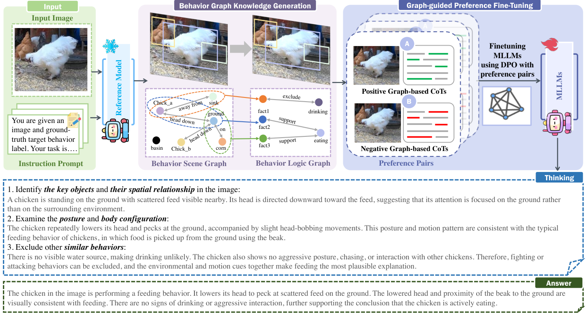
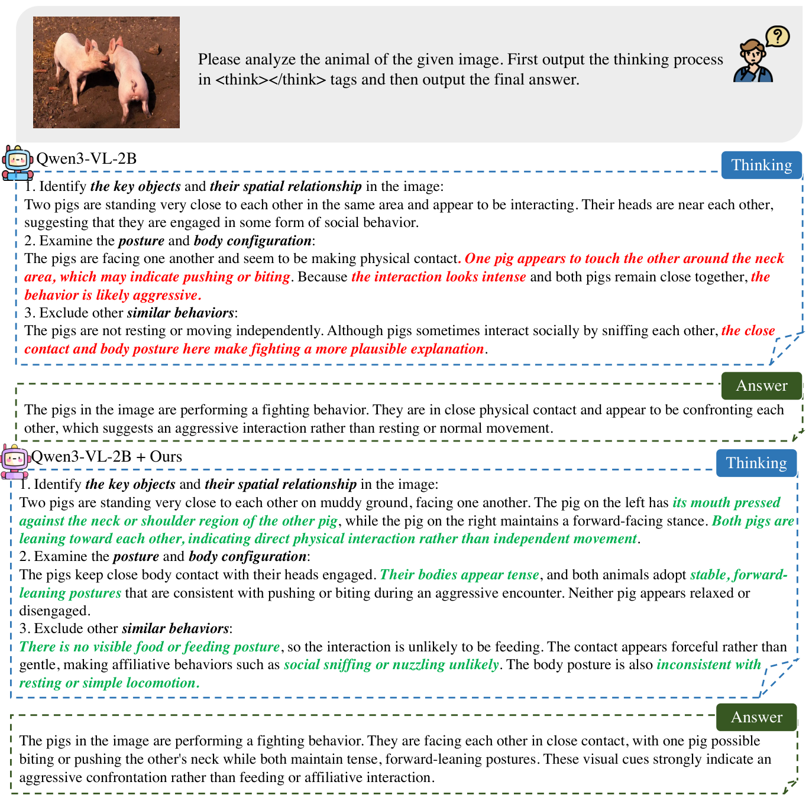
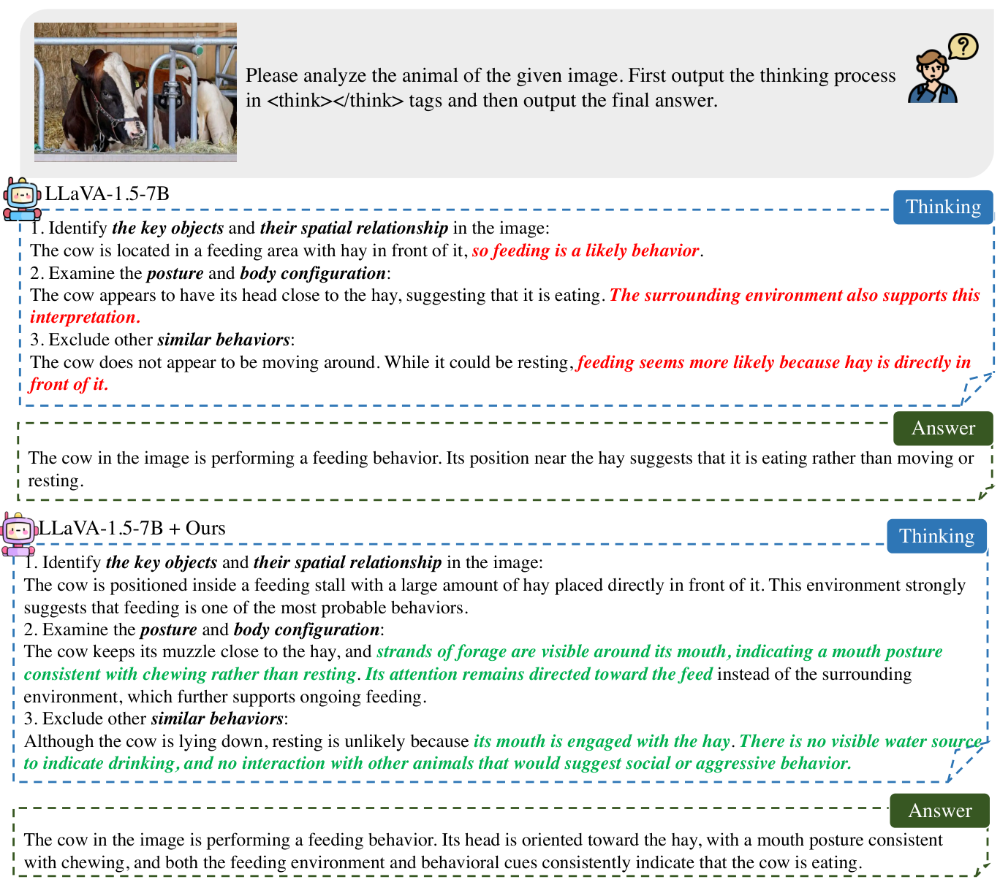

# LiveReasoner: Enhancing Interpretable Livestock Behavior Analysis via Graph-Guided Preference Alignment

> **Paper:** *LiveReasoner: Enhancing Interpretable Livestock Behavior Analysis via Graph-Guided Preference Alignment*  
> **Status:** Manuscript under review. The processed FLBE dataset and project code are planned for release after formal paper acceptance.

---

## 🧩 Key Ideas

**LiveReasoner** enhances livestock behavior recognition and explanation by guiding multimodal large language models (MLLMs) toward visually grounded, logically consistent reasoning.

1. **Behavior Graph Knowledge Generation.** A behavior scene graph represents observable entities, postures, motions, and interactions. A behavior logic graph groups evidence into facts and models their support/exclusion relations to behavior labels.
2. **Graph-guided Reasoning Preferences.** Positive reasoning chains follow the logic graph; negative chains are constructed through five perturbations: **Delete, Swap, Inject, Relation Flip, and Behavior Replacement**.
3. **Two-stage Preference Alignment.** Supervised fine-tuning (SFT) on FLBE adapts the model to livestock scenes; Direct Preference Optimization (DPO) then encourages behavior-consistent explanations over inconsistent reasoning chains.

*Figure 2. Overview of the LiveReasoner framework (from the manuscript).*

---

## 📊 Experimental Results

We evaluate LiveReasoner across four species—**pig, chicken, sheep, and cow**. The tables below summarize representative results from the manuscript; **+ Ours** denotes the corresponding model adapted using LiveReasoner. The complete manuscript reports additional model families, evaluation metrics, and ablation studies.

### Behavior Recognition

Intersection-based accuracy (**Acc**, %, from Table 5 of the manuscript):

| Model | Pig | Chicken | Sheep | Cow |
|:--|--:|--:|--:|--:|
| Qwen3.5-VL-2B | 58.73 | 40.71 | 48.39 | 71.65 |
| **Qwen3.5-VL-2B + Ours** | **65.82** | **77.85** | **83.95** | **74.21** |
| Qwen2.5-VL-3B | 56.75 | 36.87 | 44.13 | 67.55 |
| **Qwen2.5-VL-3B + Ours** | **57.35** | **72.87** | **67.29** | **71.28** |

### Explanation Quality

BART-based **NLI Score** (higher is better, from Table 6 of the manuscript):

| Model | Pig | Chicken | Sheep | Cow |
|:--|--:|--:|--:|--:|
| Qwen3.5-VL-2B | 49.85 | 34.63 | 43.75 | 39.81 |
| **Qwen3.5-VL-2B + Ours** | **58.73** | **47.81** | **53.05** | **56.27** |
| Qwen2.5-VL-3B | 44.36 | 28.15 | 33.86 | 32.70 |
| **Qwen2.5-VL-3B + Ours** | **53.46** | **42.18** | **50.33** | **51.92** |

The manuscript also evaluates generated explanations using **GPT-5 Rating** and human assessments. Please refer to the manuscript for complete results and evaluation protocols.

---

## 🎯 Qualitative Results

The following case studies (Figures 10 and 11 from the manuscript) illustrate the evidence-grounding and exclusion strategies in livestock behavior explanations.

**Pig behavior:** The adapted model uses more specific interaction cues and excludes competing explanations.

**Cow feeding:** The adapted model verifies feeding using mouth–forage contact rather than relying only on feeding-stall context.

---

## 🐄 FLBE Dataset

We construct the **Fine-grained Livestock Behavior Explanation (FLBE)** dataset to support interpretable livestock behavior analysis. Each image-level sample has behavior annotations and a fine-grained textual explanation.

| Subset | Samples | Actions | Data properties | Explanation annotations |
|:--|--:|--:|:--|:--:|
| FLBE-Pig | 55,165 | 7 | Images, pens and cages | ✓ |
| FLBE-Cow | 62,424 | 7 | Video frames, day/night surveillance | ✓ |
| FLBE-Sheep | 14,455 | 5 | Video frames, outdoor grazing | ✓ |
| FLBE-Chicken | 35,234 | 8 | Images, poultry houses | ✓ |
| **Total** | **167,278** | — | Mixed image and frame sources | ✓ |

*Statistics are based on Table 3 of the manuscript. Action counts include the consolidated “Others” category where applicable.*

### Dataset Construction

FLBE integrates public livestock behavior datasets and a limited number of images collected from public web sources. Its annotation pipeline consists of four main steps:

1. **Data collection and harmonization:** Collect images and videos, extract image-level samples, and unify species-specific behavior categories. For video sources, split videos into training and test sets **before frame extraction** to prevent video-level leakage.
2. **Ethogram collection:** Gather behavior knowledge, including context cues, visual anchors, definitions, and negative delimiters.
3. **Explanation generation:** Use a reference multimodal model with images, labels, and species-specific ethograms to generate fine-grained explanations.
4. **Explanation screening and review:** Evaluate candidate explanations for visual and semantic consistency and select the final annotations.

### Original Public Data Sources

The manuscript cites the following publicly available datasets as original sources:

| FLBE subset | Original dataset | Platform |
|:--|:--|:--|
| Pig | [Pig Behavior Dataset](https://universe.roboflow.com/swine-tktu8/pig-behavior-8xbgn) | Roboflow Universe |
| Cow | [Beef Cattle Behavior Dataset](https://www.kaggle.com/datasets/lucyfirst/beef-cattle-behavior-data-set) | Kaggle |
| Cow | [CBVD: 5-Cow Behavior Video Dataset](https://www.kaggle.com/datasets/fandaoerji/cbvd-5cow-behavior-video-dataset) | Kaggle |
| Sheep | [Sheep Behavior Dataset](https://data.mendeley.com/datasets/w65pvb84dg/1) | Mendeley Data |
| Chicken | [Chicken Behavior Dataset](https://universe.roboflow.com/avitwins02/chicken-behavior-ho0qn) | Roboflow Universe |
| Chicken | [Chicken Behavior Detection Within Real-Time](https://universe.roboflow.com/chicken-behavior/chicken-behavior-detection-within-real-time) | Roboflow Universe |

The manuscript additionally cites the **Pig-Check Challenge Dataset** released by iFLYTEK ([challenge page](https://challenge.xfyun.cn/topic/info?type=pig-check&ch=ds22-dw-kol)) and a limited number of publicly sourced web images. Please respect the original datasets' terms, licensing, and attribution requirements.

### Dataset Availability

> **The processed FLBE dataset, including its fine-grained explanation annotations, will be publicly released after the formal acceptance of the LiveReasoner paper.** Download links and release instructions will be added to this repository when available.

---

## 🏆 Contributions

- A **graph-guided preference alignment** framework for visually grounded livestock behavior reasoning.
- Complementary behavior scene and logic graphs with targeted perturbations for generating reasoning preferences.
- The **FLBE benchmark**, containing **167,278 image-level samples** across four livestock species with fine-grained explanatory annotations.

---

## 📄 Paper

**LiveReasoner: Enhancing Interpretable Livestock Behavior Analysis via Graph-Guided Preference Alignment**  
*Manuscript under review. A public manuscript link will be added when available.*

---

## 📌 Citation

A BibTeX entry will be provided when the paper is publicly available.

---

## ⭐ Acknowledgements

We thank the creators of the public livestock behavior datasets linked above and acknowledge their contributions to animal behavior research.
